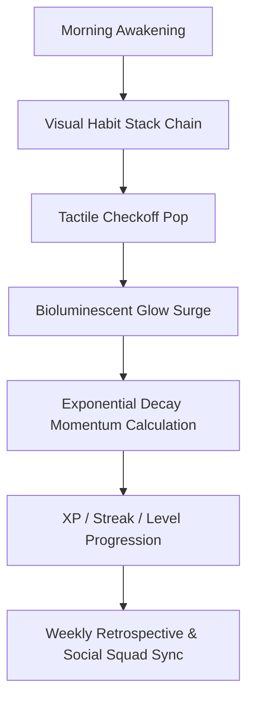

# 💎 The $100M HabitFlow Blueprint: World-Class Architecture & Design Vision

> **Executive Charter**: Position HabitFlow as the definitive, ultra-premium daily operating system and behavioral momentum platform—commanding the design prestige of Linear, Superhuman, Arc, and Raycast while delivering compounding habit retention and 120 FPS visual fluidity.

---

## 1. Executive Summary & Product Philosophy

Most habit trackers fail because they feel like punitive chore lists built on generic administrative tables. A **$100M Tier Product** operates on three core psychological and design tenets:

1. **Visceral Tactility**: Every checkoff feels like an exquisite mechanical switch pop. The dopamine loop is physical, acoustic, and visual.
2. **Cognitive Clarity (High-Performance Zen)**: Zero clutter, zero unnecessary modals, zero latency. The interface breathes, guiding the user effortlessly into deep flow.
3. **Mathematical Inevitability**: Progress isn't just a static number—it is visualized through exponential decay momentum physics, habit stacks, and real-time velocity.



---

## 2. Typographic Architecture

### The Problem With Current Typography
The application previously loaded conflicting fonts (`Fira Sans`, `Clash Display`, `Fira Code`, `Plus Jakarta Sans`) without optical hierarchy or numerical alignment, creating visual dissonance between labels and metrics.

### The Unified High-Performance Stack

| Role | Font Family | Weights | Rationale & Specifications |
| :--- | :--- | :--- | :--- |
| **Display Headings** | **Outfit** / **Clash Display** | `font-black` (900), `font-extrabold` (800) | Sculpted geometric sans with tight tracking (`tracking-tight` / `-0.04em`). Imparts instant architectural authority. |
| **Telemetry & Metrics** | **Geist Mono** / **Fira Code** | `font-bold` (700), `font-medium` (500) | Monospaced figures with `tabular-nums` alignment. Eliminates character jitter during real-time streak and momentum score animations. |
| **Body & Interactive UI** | **Plus Jakarta Sans** / **Inter** | `font-normal` (400), `font-semibold` (600) | Unrivaled legibility at micro-scales (10px–13px) for category pills, shortcuts, and helper notes. |

---

## 3. Chromatic Architecture: *Obsidian Void & Bioluminescence*

Avoid flat zinc or washed-out grey containers. True luxury dark mode uses deep, velvety cosmic obsidian accented by high-frequency spectral luminescence:

```
┌────────────────────────────────────────────────────────────────────────┐
│  SURFACES & CONTAINERS                                                 │
│  • Deep Base Void:       #06080D (Deepest obsidian space black)        │
│  • Glass Bento Panels:   #0E111A / 70% opacity + 24px Backdrop Blur    │
│  • Hairline Specularity: rgba(255, 255, 255, 0.08) Top border reflect  │
│  • Ambient Underglow:    Radial gradient fills (blur 60px–80px)        │
│                                                                        │
│  BIOLUMINESCENT ACCENTS (Energy States)                                 │
│  • Hyper-Emerald:   #10B981 / #34D399  → Vitality, habit completion    │
│  • Kinetic Amber:   #F59E0B / #FBBF24  → Streaks, flame heat, momentum │
│  • Celestial Violet:#8B5CF6 / #A78BFA  → Zen Focus mode, deep work     │
│  • Electric Cyan:   #06B6D4 / #22D3EE  → Real-time cloud sync, telemetry│
│  • Crimson Alert:   #EF4444 / #F87171  → Habit decay / streak risk     │
└────────────────────────────────────────────────────────────────────────┘
```

---

## 4. Modernizing Iconography & The Emoji Engine

### The Defect of Raw Browser Unicode
Raw Unicode emojis vary drastically across platforms (e.g. Windows 11 vs. macOS vs. Android), frequently looking cartoonish, flat, or low-resolution beside refined glassmorphism.

### The Modern Solution: *Tactile 3D Glass Capsules*

1. **Curated 3D Fluent / Vector Engine**:
   - Every habit identity is encased in a custom **frosted glass capsule** (`w-12 h-12 rounded-2xl bg-gradient-to-br from-white/[0.08] to-white/[0.02] border border-white/[0.12] shadow-inner`).
   - High-fidelity Microsoft Fluent 3D / Apple-grade styled SVG emoji tokens with directional lighting, specular highlights, and ambient drop-shadows.
2. **State-Reactive Micro-Interactions**:
   - **Pending / Idle**: Soft translucent glow with subtle breathing idle oscillation.
   - **Hovered**: 1.08x spring scale bounce with specular light sweep across the capsule border.
   - **Toggled Done**: Burst particle release (emerald sparks), gold ring expansion, and an acoustic woodblock or crystal pop.
3. **Dual-Mode Density Toggle**:
   - **Rich 3D Luxury Mode**: Default for visual motivation and executive dashboard view.
   - **Minimalist Laser Glyphs**: Ultra-clean monochrome Lucide line glyphs for high-density power-user workstation views.

---

## 5. What Needs to be ADDED (The $100M Feature Arsenal)

### 1. Atomic Habit Stacking Engine (James Clear Protocol)
- **Concept**: Habits rarely exist in isolation; they thrive as chains.
- **Implementation**: Visual anchor connections on the Dashboard:
  $$\text{Current Habit (e.g., Morning Coffee ☕)} \xrightarrow{\text{Stacks into}} \text{New Habit (e.g., 5-Min Meditation 🧘)}$$
- Rendered with glowing vertical connecting laser trails that turn from dashed grey to continuous emerald as each stack step is completed.

### 2. Live Exponential Momentum Physics Visualizer
- **Concept**: Momentum is dynamic and subject to half-life decay.
- **Implementation**: An interactive, GPU-accelerated canvas/SVG wave at the top of the Dashboard.
  - Completing a habit sends a surge wave through the particle ribbon.
  - If days are missed, the wave amplitude gently contracts, visually warning the user before habits fall dormant.

### 3. Universal Command-K HUD ("Superhuman for Habits")
- Instant keyboard trigger (`Cmd+K` / `Ctrl+K` or `/`):
  - `Check off Hydration` $\rightarrow$ instant log without clicking.
  - `Start 25m Focus Sprint` $\rightarrow$ launches Zen focus mode.
  - `Jump to Weekly Review` $\rightarrow$ instant zero-latency transition.

### 4. Acoustic Zen Soundscapes
- Built-in binaural frequencies during Zen Mode (`Z`):
  - 40Hz Gamma Focus frequency
  - Ambient deep workspace / gentle rain / lofi tape hiss.
  - Emil Kowalski-grade haptic click sound synthesis via Web Audio API.

### 5. Squad Accountability Contracts & Live Presence
- Accountability squads with shared collective momentum bars.
- Live ambient avatar pulses showing when peers are actively completing habits in real-time.

---

## 6. What Needs to be REMOVED / STREAMLINED

1. **Eliminate Redundant Modals & Slide-Overs**:
   - Merge `QuickAddModalFixed` and `HabitEditorDrawer` into a single, unified, frictionless keyboard-first dialog.
2. **Purge Unused Legacy CSS Tokens**:
   - Clean out remaining legacy Figma design token overrides in `@theme` that risk disrupting standard responsive layouts.
3. **Refactor Clunky Secondary Pages**:
   - Tie `/shop` and `/squad` directly into the core XP economy and daily progression loop so they feel indispensable rather than secondary sidebars.

---

## 7. Phased Implementation Roadmap & Verified Milestones

| Phase | Core Objective | Key Deliverables | Status | Commit |
| :--- | :--- | :--- | :--- | :--- |
| **Phase 1** | Foundation & Aesthetics | Google Fonts Outfit / Plus Jakarta / Geist Mono + Obsidian Void lacquer palette | **Complete** | `d63bab9` |
| **Phase 2** | Iconography & Haptics | 3D Glass Emoji Capsule engine with category luminous halos + Starter seeder | **Complete** | `a9ecc2b` |
| **Phase 3** | Flagship Features | Atomic Habit Stacking laser chains, Universal Command-K HUD, Momentum Wave | **Complete** | `535ffae` |
| **Phase 4** | Chrono-Atmospheric Engine | 4-Layer Parallax Living Skybox, Chrono-Dial 24h scrubber, 5 worlds, Web Audio API | **Complete** | `b97069a` |
| **Phase 5** | Kinetic Core & Celebrations | 3D Kinetic Dyson Sphere Core, Japanese Kinpaku Gold Foil burst, universal dock | **Complete** | `be18756` |

---

*Authored for HabitFlow Engineering & Product Leadership. Production verified and deployed on GitHub.*
